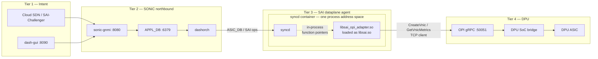
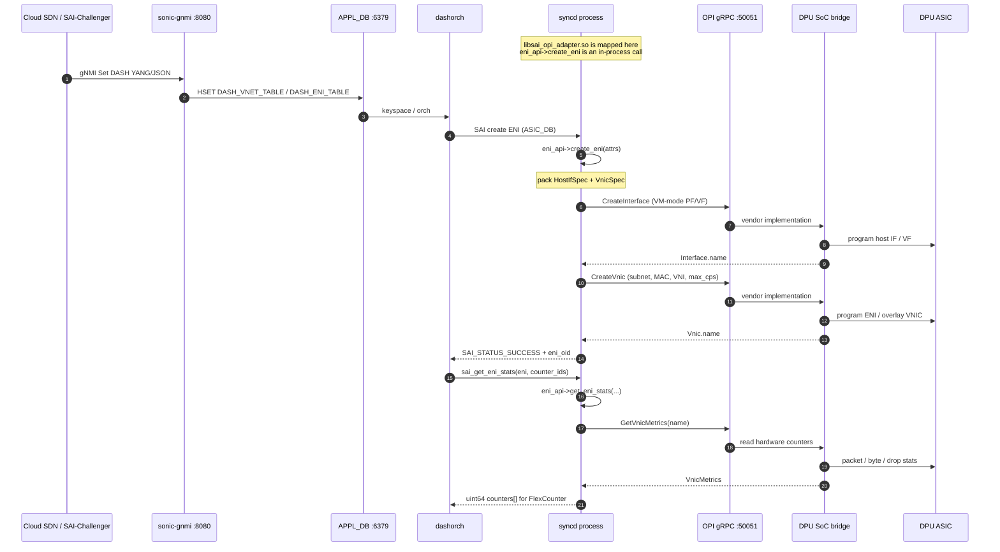
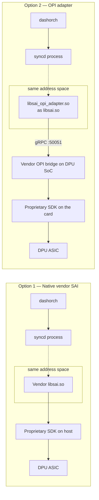

<!--
SPDX-License-Identifier: Apache-2.0
SPDX-FileCopyrightText: 2026 The dash-opi-map Authors
-->

# DASH SAI → OPI gRPC Adapter

**A vendor-neutral SAI library that turns SONiC DASH overlay programming into OPI Cloud gRPC, so host control planes do not bind to a proprietary DPU driver.**

This repository is intended for the [SONiC DASH](https://github.com/sonic-net/DASH) community and the [Linux Foundation OPI](https://opiproject.github.io/) working groups. It contains:

- **User guide (run the lab):** [`docs/user-guide.md`](docs/user-guide.md) — every `labctl` step, expected logs, and the NVIDIA E2E gate
- The DASH SAI ↔ OPI object mapping contract ([`docs/dash-opi-object-mapping.md`](docs/dash-opi-object-mapping.md), [`mapping/dash-opi.yaml`](mapping/dash-opi.yaml))
- Hop-by-hop live vs mapping-only: [`docs/dash-api-flow-status.md`](docs/dash-api-flow-status.md)
- A C++ **in-process** SAI vendor library (`libsai_opi_adapter.so`, `dlopen`ed by `syncd` as `libsai.so`) that issues `CloudInfraService` / `TelemetryService` RPCs
- A host-portable control plane ([`deploy/docker-compose.sonic-stack.yml`](deploy/docker-compose.sonic-stack.yml): `sonic-gnmi`, APPL_DB, `dashorch`, `syncd`) and SAI-Challenger / gnmi-cli verification
- Lab controller [`scripts/labctl.sh`](scripts/labctl.sh) (preflight → setup-dpu → setup-host → run / setup-sonic / run-sonic); site IPs in gitignored [`config/lab.env`](config/lab.env.example)

**NVIDIA BlueField-2 networking path is E2E:** gNMI → adapter → CloudInfra `:50051` for VNET, ENI, outbound routing, and ACL create + delete. OVS: [`example-output/run-sonic-nvidia-success.txt`](example-output/run-sonic-nvidia-success.txt) (`24 passed, 0 failed`). DOCA Flow eSwitch (`DATAPATH=doca`): [`example-output/run-sonic-nvidia-doca-success.txt`](example-output/run-sonic-nvidia-doca-success.txt) (`49 passed, 0 failed`; `cleanup` restored `ovsbr1`). Start there with the [user guide](docs/user-guide.md).

| Layer | What it is |
| --- | --- |
| Host | `sonic-gnmi` → APPL_DB → `dashorch` → `syncd` (standard SONiC SAI C ABI) |
| Adapter | `libsai_opi_adapter.so` **inside the `syncd` process** (`dlopen("libsai.so")`) |
| Wire | OPI gRPC — CloudInfra `:50051` (DASH) and SNAP `:50052` (inventory / NVMe / IPsec) |
| DPU SoC | Vendor CloudInfra daemon (`dpu/nvidia` or `dpu/intel`) plus datapath (OVS or DOCA Flow eSwitch) |
| DPU ASIC | Hardware tables programmed by the vendor runtime, not by SONiC |

---

## Table of contents

0. **[User guide — run the lab](docs/user-guide.md)** (step-by-step; start here)
1. [Executive summary and value proposition](#1-executive-summary-and-value-proposition)
2. [Architecture overview](#2-architecture-overview)
3. [Object mapping (contract)](#3-object-mapping-contract)
4. [Current implementation status](#4-current-implementation-status)
5. [Prerequisites and lab setup](#5-prerequisites-and-lab-setup)
6. [Build and installation](#6-build-and-installation)
7. [Execution and verification](#7-execution-and-verification)
8. [Expanded use cases](#8-expanded-use-cases)
9. [Community presentation outline](#9-community-presentation-outline)
10. [Sources and related work](#10-sources-and-related-work)
11. [Troubleshooting & FAQs](#11-troubleshooting--faqs)
12. [License](#license)

---

## 1. Executive summary and value proposition

SONiC DASH (Disaggregated API for SONiC Hosts) programs tenant overlay objects — ENI, VNET, outbound routing, ACL — through the SAI C ABI that `dashorch` already uses. On a SmartNIC / DPU / IPU, those objects must land in **hardware tables on the DPU ASIC**, not in a software switch on the host.

The industry default today is **Option 1: native vendor SAI**. The host `syncd` process `dlopen()`s a vendor `libsai.so`. That library talks a proprietary SDK (DOCA, IPDK, Pensando DSC, …) to the card. The SONiC image, the SAI .so, and the DPU firmware become a **single-vendor stack**. Swapping a BlueField for an Intel IPU, or an AMD Pensando DSC, means a different SAI library, different packaging, and a different failure domain.

**Option 2 — this repository — inserts an OPI adapter in place of that vendor SAI library.** `dashorch` still calls `sai_create_eni` / `sai_get_eni_stats`. The adapter translates those calls into OPI `CreateVnic` / `GetVnicMetrics` (and the rest of `CloudInfraService`) and sends them over gRPC to whatever implements OPI on the DPU ARM/x86 SoC. The vendor’s closed SDK stays **behind** the OPI server, on the card.

That split is the value:

| Concern | Why OPI-based DASH matters |
| --- | --- |
| Control-plane portability | One SONiC image programs any DPU that speaks OPI Cloud. Host orchagent does not link a vendor SDK. |
| Hardware multi-vendor | NVIDIA, Intel IPDK, AMD Pensando, and future IPUs compete on the **bridge + ASIC**, not on a bespoke SAI .so per SONiC build. |
| Operational boundary | The DPU SoC owns device drivers, firmware, and table programming. The host owns tenant intent (APPL_DB). A card crash does not require a vendor-specific host SAI rebuild. |
| Open contract | DASH objects map to published protobuf (`Vnic`, `Vpc`, `Route`, `SecurityPolicy`) instead of undocumented SDK structs. |
| Stats without a second ABI | FlexCounter keeps calling `sai_get_eni_stats`. The adapter reads OPI telemetry on the same gRPC channel. |

OPI does not replace SAI on the host. SAI remains the **northbound** ABI that SONiC already has. OPI is the **southbound** ABI to the DPU. The adapter is the seam.

---

## 2. Architecture overview

The control plane is four tiers. **`libsai_opi_adapter.so` is not a sidecar, daemon, or Unix-socket peer.** `syncd` maps it into its own address space (the same `dlopen("libsai.so")` path every SONiC ASIC backend uses). The only network hop the adapter originates is OPI gRPC to the DPU SoC (`:50051`).

### 2.1 Four-tier system view



| Tier | Component | Role |
| --- | --- | --- |
| 1 | Cloud SDN or [SAI-Challenger](https://github.com/opencomputeproject/SAI-Challenger) | Standard DASH YANG/JSON intent |
| 2 | `sonic-gnmi` `:8080` → APPL_DB `:6379` → `dashorch` | gNMI Set into `DASH_*_TABLE`; orchagent turns hashes into SAI |
| 3 | `syncd` **process** hosting `libsai_opi_adapter.so` | `dlopen` + `sai_api_query`; C calls never leave this address space |
| 4 | OPI `:50051` → DPU SoC bridge → DPU ASIC | Protobuf on the wire; vendor SDK stays on the card |

The host never opens a DOCA or IPDK handle. Stubs on the long-lived gRPC channels are thread-safe. SAI stays synchronous: the adapter wraps unary RPCs in `BlockingUnary` and does **not** hold object-store locks across the RPC wait.

### 2.2 Execution mechanics (in-memory SAI)

SONiC `syncd` is written against the vendor SAI C ABI. It does not `fork` a translator and it does not speak OPI itself. The adapter is ordinary ELF mapped by the dynamic loader.

**`dlopen` bootstrapping.** On startup `syncd` loads the vendor library the way every SONiC image does:

```c
void* h = dlopen("libsai.so", RTLD_NOW);
/* then dlsym sai_api_initialize, sai_api_query, … */
```

`RTLD_NOW` resolves `sai_api_initialize`, `sai_api_query`, `sai_create_eni`, `sai_get_eni_stats`, and the gRPC/protobuf symbols the adapter needs before `syncd` continues. A missing `libgrpc++` here is a loader failure, not a later RPC error.

**Symlink redirection.** [`scripts/install_libsai_opi_adapter.sh`](scripts/install_libsai_opi_adapter.sh) (and the persist hook in §6.4) installs the adapter next to the vendor library and points the name `syncd` already opens at it:

```bash
install -m 0755 libsai_opi_adapter.so /usr/lib/libsai_opi_adapter.so
ln -sfn libsai_opi_adapter.so /usr/lib/libsai.so
```

`readlink /usr/lib/libsai.so` must resolve to `libsai_opi_adapter.so`. The SONAME `syncd` `dlopen`s remains `libsai.so`; only the inode behind that name changes. In the compose lab the same file is bind-mounted into the `syncd` container at `/usr/lib/libsai_opi_adapter.so`.

**Function-pointer query.** After `sai_api_initialize` (which opens CloudInfra from `OPI_SERVER_ADDRESS` and SNAP from `OPI_SNAP_ADDRESS`, and calls `InventoryService.GetInventory`), `syncd` calls:

```c
sai_dash_eni_api_t* eni_api = NULL;
sai_api_query(SAI_API_DASH_ENI, (void**)&eni_api);
/* eni_api->create_eni      → sai_create_eni
   eni_api->get_eni_stats   → sai_get_eni_stats   */
```

Those pointers are addresses **inside the mapped `.so`**, stored on `syncd`’s heap. They are not RPC stubs and not a second process.

**Zero-IPC execution on the host.** When `dashorch` pushes ENI/VNET state (via ASIC_DB / sairedis, same as a Broadcom `libsai.so`), `syncd` invokes `eni_api->create_eni(...)` as a normal C call: same thread, same address space, no Unix socket, no gRPC to localhost. Inside that call the adapter:

1. Packs `sai_attribute_t[]` into OPI `CreateInterfaceRequest` / `CreateVnicRequest` (or `GetVnicMetricsRequest` for stats)
2. Acts as the **gRPC client** to `OPI_SERVER_ADDRESS` (TCP **`:50051`** CloudInfra on the DPU SoC)
3. Returns `sai_status_t` and object ids / `uint64_t counters[]` to `syncd`

Host IPC stops at `dashorch` ↔ `syncd` (SONiC Redis). Adapter ↔ DPU is OPI gRPC. There is no adapter daemon.

Target resolution (`sai_api_initialize` via `src/dash_opi/channel.cc`):

**CloudInfra + Telemetry** (`OPI_SERVER_ADDRESS`):

1. Environment `OPI_SERVER_ADDRESS`
2. `/etc/sonic/opi.env` (survives `syncd` container recreate; bind-mounted)
3. `/etc/sai.d/opi.env`
4. `sai.profile` via `profile_get_value`
5. Fallback `127.0.0.1:50051`

**SNAP inventory / NVMe / IPsec** (`OPI_SNAP_ADDRESS`):

1. Environment `OPI_SNAP_ADDRESS`
2. Same env files / `sai.profile`
3. Sibling of the CloudInfra host on **`:50052`**

CloudInfra connect failure fails initialize. SNAP / `GetInventory` failure is logged and does **not** block DASH unless `OPI_REQUIRE_SNAP=1` or `OPI_REQUIRE_INVENTORY=1`.

### 2.3 End-to-end control flow (create ENI + read counters)



### 2.4 Native SAI (Option 1) versus OPI adapter (Option 2)



| | Option 1: native SAI | Option 2: OPI adapter |
| --- | --- | --- |
| Host ABI | SAI (`dlopen("libsai.so")`) | Same name and `dlopen` |
| Where the `.so` runs | `syncd` address space | `syncd` address space (this repo’s ELF) |
| Southbound | Vendor SDK **from the host process** | OPI gRPC **from the same process** to the DPU |
| SONiC rebuild per NIC vendor | Yes | No — swap the DPU bridge, keep the adapter |
| Multi-vendor lab | N vendor SAI libraries | 1 adapter + N OPI bridges |
| Failure domain | Vendor SAI crash takes `syncd` with a closed stack | Adapter is open; vendor bugs stay on the card |
| Standards body | OCP SAI | OCP SAI in-process + LF OPI on the wire |

Option 1 is still valid for a single-vendor appliance. Option 2 is the path when the host NOS must outlive any one DPU vendor. In both options the SAI library is **in-process**; Option 2 only changes *which ELF* `libsai.so` names and *where* the proprietary SDK is allowed to run.

---

## 3. Object mapping (contract)

DASH overlay headers are generated from P4 into OCP SAI experimental files (`saiexperimentaldasheni.h`, `saiexperimentaldashvnet.h`, …). There is no `saidash.h` / `saieni.h` in current trees. OPI Cloud lives in package `opi_api.network.cloud.v1alpha1`.

| DASH object | SAI type / header | OPI messages | Proto | gRPC |
| --- | --- | --- | --- | --- |
| **ENI** | `SAI_OBJECT_TYPE_ENI` in `saiexperimentaldasheni.h` | `Vnic`, `Interface` / `HostIfSpec` | `vnic.proto`, `interface.proto` | `CreateVnic`, `CreateInterface`, … |
| **ENI stats** | `sai_get_eni_stats` | `VnicMetrics` | `telemetry/v1/telemetry.proto` (this repo) | `TelemetryService.GetVnicMetrics` |
| **VNET** | `SAI_OBJECT_TYPE_VNET` | `Vpc`, optional `Subnet` | `vpc.proto`, `subnet.proto` | `CreateVpc`, … |
| **Outbound routing** | group + entry | `RouteTable`, `Route` | `route.proto` | `CreateRouteTable` / `CreateRoute` |
| **ACL** | group + rule | `SecurityPolicy`, `SecurityRule` | `networkpolicy.proto` | `CreateSecurityPolicy` / `CreateSecurityRule` |

Official OPI `inventory.proto` is SMBIOS/FRU only (`InventoryService.GetInventory` on SNAP `:50052`). Packet and byte counters are read from `TelemetryService` on the **CloudInfra** gRPC server (`:50051`).

Field-level maps, ACL stage collapse, routing action translation, and known gaps: [`docs/dash-opi-object-mapping.md`](docs/dash-opi-object-mapping.md). Machine-readable copy: [`mapping/dash-opi.yaml`](mapping/dash-opi.yaml). Hop-by-hop **supported vs not** (Challenger → ASIC): [`docs/dash-api-flow-status.md`](docs/dash-api-flow-status.md).

```bash
python3 tools/render_mapping.py
```

---

## 4. Current implementation status

Publish this honestly to both communities.

| Area | Status |
| --- | --- |
| Mapping contract (ENI, VNET, routing, ACL) | Complete in YAML + docs |
| `sai_api_initialize` / `sai_api_query` / `sai_api_uninitialize` | Implemented; `SAI_API_DASH_ENI` + `SAI_API_DASH_VNET` + `SAI_API_DASH_OUTBOUND_ROUTING` + `SAI_API_DASH_ACL` live; `GetInventory` on SNAP `:50052` |
| `sai_create_eni` | Implemented: `CreateInterface` then `CreateVnic`; rollback `DeleteInterface` on Vnic failure |
| `sai_remove_eni` | Implemented: `DeleteVnic` then `DeleteInterface`; unknown oid is `ITEM_NOT_FOUND` |
| `sai_create_vnet` | Implemented: `CreateVpc` then `CreateSubnet`; binds ObjectStore for ENI |
| `sai_remove_vnet` | Implemented: `DeleteSubnet` then `DeleteVpc` |
| `sai_get_eni_stats` | Implemented: `GetVnicMetrics` → SAI counter arrays |
| Multi-port gRPC (`channel.cc`) | CloudInfra `:50051` + SNAP `:50052`; `OPI_SNAP_ADDRESS` |
| `sai_opi_create_nvme_controller` / `sai_opi_enable_ipsec` | Implemented: SNAP `CreateNvmeController` + `IPsecInitiate`/`IPsecRekey` |
| Outbound routing SAI entry points | **E2E** group + entry create/remove → `CreateRouteTable` / `CreateRoute`. |
| ACL SAI entry points | **E2E** group + rule create/remove → `CreateSecurityPolicy` / `CreateSecurityRule`. |
| NVIDIA BF2 lab (`labctl run-sonic`) | **E2E** gNMI → APPL_DB → dashorch → syncd → CloudInfra for VNET/ENI/Route/ACL create + ENI delete. |
| Python mock `CloudInfraService` + `TelemetryService` | Implemented (`tests/opi_server/server.py`) |
| DPU bridge / SONiC compose / APPL_DB verify | Implemented (`labctl.sh`, `deploy/`) |

ENI create requires a prior successful `sai_create_vnet` (or legacy `dash_opi_bind_vnet`) so `ObjectStore` has the subnet name for `SAI_ENI_ATTR_VNET_ID`.

gRPC codes map to the SAI statuses orchagent already handles: `NOT_FOUND` → `ITEM_NOT_FOUND`, `RESOURCE_EXHAUSTED` → `TABLE_FULL`, and so on (`src/dash_opi/status.cc`).

---

## 5. Prerequisites and lab setup

### 5.1 Minimum hardware

| Role | Requirement |
| --- | --- |
| Host | x86_64 or aarch64 server that can run SONiC (`syncd` + `orchagent`) or a SONiC VS/container lab |
| DPU / IPU | One card whose SoC can run Linux and this repo’s CloudInfra daemon. Validated: NVIDIA BlueField-2 (`dpu/nvidia`). Intel IPU Phase A: `dpu/intel`. SNAP storage bridges are not DASH CloudInfra. |
| Host ↔ DPU network | L3 reachability to CloudInfra on the DPU ARM IP (`DPU_IP:50051`). Validated lab uses **OOB** (e.g. `172.22.3.2`), not RShim `tmfifo_net0`. TCP 50051 must be open. |
| Data-plane (iperf3) | Two tenant endpoints (VMs or containers) whose vNICs are ENIs on the DPU, plus underlay connectivity the vendor bridge programs (VXLAN). |

A software-only loop (no DPU) is enough to test translation: host adapter + Python mock on `:50051`.

### 5.2 Minimum software

| Component | Notes |
| --- | --- |
| Host kernel | Linux 5.15+ recommended (BlueField host drivers / vfio-pci / virtio-net as required by the vendor). SONiC’s own kernel is sufficient when running a SONiC image. |
| Build | CMake ≥ 3.16, C++17 compiler (`g++` 9+ or clang 11+), Git |
| gRPC / Protobuf | C++ packages discoverable as `gRPC CONFIG` and `Protobuf` (`libgrpc++-dev`, `protobuf-compiler`, `protobuf-dev`, or a from-source gRPC prefix). CMake also FetchContents [opiproject/opi-api](https://github.com/opiproject/opi-api) and [googleapis](https://github.com/googleapis/googleapis). |
| SAI headers | Production: OCP SAI `inc/` + `experimental/` (`-DSAI_INCLUDE_DIR=…`). Lab: `third_party/sai-stub/` in this repo. |
| Docker | On the **DPU SoC** for the OPI bridge; on the host if SONiC `syncd` runs as a container. |
| Python 3.10+ | Mock server and e2e helper (`grpcio`, `grpcio-tools`; see `tests/opi_server/requirements.txt`). |
| Vendor DPU runtime | **NVIDIA:** DOCA (and BlueField OS) so `opi-nvidia-bridge` can attach to vendor sockets under `/var/tmp`. **Intel:** IPDK / P4 DPDK or the vendor’s OPI server. **Others:** the runtime their OPI bridge documents. The adapter does not link these SDKs. |
| Optional clients | `grpc_cli`, `grpcurl`, or `opi-cli` for hardware queries. `namely/grpc-cli` is a Docker fallback (amd64; prefer a native `grpc_cli` on ARM DPUs). |

### 5.3 Reference lab addressing

Script defaults assume a typical RShim `/30` (host `.2`, DPU `.1`). **Your site
IPs belong in a local config file**, not in `labctl.sh`:

```bash
cp config/lab.env.example config/lab.env   # gitignored — edit once
# set DPU_IP / HOST_IP / SSH_TARGET for your rack
```

`config/lab.env.example` is seeded for an OOB lab (`DPU_IP=172.22.3.2`,
`HOST_IP` = host address on that LAN). **`HOST_IP` is not tmfifo_net0** — RShim
is optional sideband; CloudInfra/SSH use the OOB path. CLI flags still override
the file for one-off runs.

Related files:

| File | Purpose |
| --- | --- |
| [`config/lab.env`](config/lab.env.example) | **Single** lab file: IPs, DATAPATH, DPU prereqs (gitignored local copy) |
| `build/opi.env` | Written by `labctl setup-sonic` from `DPU_IP` + ports |
| [`deploy/sonic-stack.env.example`](deploy/sonic-stack.env.example) | Optional compose image overrides if you run compose by hand |

---

## 6. Build and installation

Operator cookbook (every step, expected logs, green `run-sonic`): **[`docs/user-guide.md`](docs/user-guide.md)**.

All DASH lab bring-up is driven from the **host** by [`scripts/labctl.sh`](scripts/labctl.sh) (`from_host.sh` still works as a wrapper).

| Step | Command | What it does |
| --- | --- | --- |
| (a) | `labctl.sh preflight` | Host PCIe, ping `DPU_IP`, then read-only DPU inspect. RShim is **WARN** only. |
| — | `labctl.sh inspect-dpu` | SoC inventory only (OVS, DOCA, representors, listeners). No changes. |
| (b) | `labctl.sh setup-dpu` | CloudInfra **:50051** (DASH) and SNAP **:50052** (storage). |
| (c) | `labctl.sh setup-host` | cmake-build `libsai_opi_adapter.so` and `test_sai_create_eni`. |
| (d) | `labctl.sh run` | C ABI smoke: `sai_create_eni` → DPU CloudInfra. |
| (e) | `labctl.sh setup-sonic` | Compose `sonic-gnmi`, APPL_DB, `dashorch`, `syncd` → DPU `:50051`. |
| (f) | `labctl.sh run-sonic` | gNMI / SAI-Challenger northbound path. |
| — | `labctl.sh cleanup` | Stop CloudInfra, delete `br-opi`, optional SNAP, compose down. Does **not** touch vendor `ovsbr1` / `p0`. |

`libsai_opi_adapter.so` executes **inside `syncd`** after `setup-sonic` (or a NOS install in §6.3). `(d) run` talks gRPC directly and does not need compose.

SNAP (`opi-nvidia-bridge`) is storage/inventory on **`:50052`**. Point the adapter at CloudInfra on **`:50051`**, never at SNAP.

### 6.1 Lab controller (`labctl.sh`)

```bash
# once per machine — do not put IPs in labctl.sh
cp config/lab.env.example config/lab.env
# edit config/lab.env: DPU_IP, HOST_IP, SSH_TARGET

./scripts/labctl.sh preflight
./scripts/labctl.sh setup-dpu
./scripts/labctl.sh setup-host
./scripts/labctl.sh run                 # C ABI
./scripts/labctl.sh setup-sonic         # SONiC control plane
./scripts/labctl.sh run-sonic           # gNMI

# or:
./scripts/labctl.sh all                 # a–d
./scripts/labctl.sh all-sonic           # a–c + e + f

./scripts/labctl.sh cleanup
# ./scripts/labctl.sh cleanup --keep-snap --keep-sonic

# one-off override (optional):
# ./scripts/labctl.sh setup-dpu --dpu-ip 172.22.3.2 --ssh root@172.22.3.2
# ./scripts/labctl.sh setup-dpu --vendor intel
```

Precedence: **CLI flags > `config/lab.env` > script defaults**.

**(a) Preflight** checks the card is on PCIe and `DPU_IP` answers ping. Missing RShim/`tmfifo_net0` is a **WARN** (OOB/BMC labs). It skips gRPC on purpose: CloudInfra is not running yet.

**(b) Setup DPU** builds the vendor SoC daemon (ARM64, host Go image — do **not** pass `--platform linux/arm64`), `scp`s it, and starts listeners. Default `--vendor nvidia` (`dpu_cloudinfra_bridge`). Intel Phase A: `--vendor intel` (`dpu_intel_bridge`, no SNAP).

| Port | Service | Role |
| --- | --- | --- |
| **`:50051`** | NVIDIA `dpu_cloudinfra_bridge` or Intel `dpu_intel_bridge` | DASH `CloudInfraService` / `TelemetryService` (adapter target) |
| **`:50052`** | SNAP `opi-nvidia-bridge` | storage / inventory / IPsec (Redis + docker on the DPU) |

They cannot share `:50051`. Pass `--no-snap` if you want CloudInfra only. The daemon implements create/delete for Interface, Vnic, Vpc, Subnet, RouteTable, Route, SecurityPolicy, SecurityRule, plus `GetVnicMetrics`, and programs representors plus OVS / `tc-flower`.

**(c) Setup host** is `cmake -B build` plus the adapter `.so` and the C usecase binary.

**(d) Run** executes `./build/test_sai_create_eni <dpu-ip>:50051`. Success is create + stats RPC. Hardware counters are not the mock golden set. `sai_api_initialize` also probes SNAP `:50052` (`GetInventory`); NVMe/IPsec helpers run only with a second argument or `SAI_OPI_SNAP_OFFLOAD=1`.

**(e) Setup SONiC** starts [`deploy/docker-compose.sonic-stack.yml`](deploy/docker-compose.sonic-stack.yml) **without** `mock-opi`, with `OPI_SERVER_ADDRESS=<dpu>:50051` so `syncd` reaches CloudInfra. The lab `syncd` image is **Ubuntu 22.04** (`libprotobuf23` / `libgrpc++1`) so a jammy-built `libsai_opi_adapter.so` can `dlopen`. `setup-sonic` fails if `ldd` inside the container still shows `not found`.

**(f) Run SONiC** is gNMI / SAI-Challenger (`run_sai_challenger.sh --no-compose`). Green is `N passed, 0 failed` with all 16 CloudInfra RPC names including ENI `DeleteVnic` / `DeleteInterface`. OVS: [`example-output/run-sonic-nvidia-success.txt`](example-output/run-sonic-nvidia-success.txt). DOCA: [`example-output/run-sonic-nvidia-doca-success.txt`](example-output/run-sonic-nvidia-doca-success.txt). See the [user guide](docs/user-guide.md).

**Cleanup** stops the vendor CloudInfra daemon (`dpu_cloudinfra_bridge` and/or `dpu_intel_bridge`), restores representor MACs snapshotted on first `setup-dpu`, deletes **`br-opi` only** (never `ovsbr1` / `ovsbr2`), removes SNAP unless `--keep-snap`, and brings compose down unless `--keep-sonic`.

After (b) you can list services yourself:

```bash
# DASH CloudInfra
sudo docker run --rm --network=host namely/grpc-cli \
  ls --json_input --json_output 172.22.3.2:50051 -l
# SNAP storage (Inventory / Nvme / IPsec — not CloudInfra)
sudo docker run --rm --network=host namely/grpc-cli \
  ls --json_input --json_output 172.22.3.2:50052 -l
```

On `:50051` expect `opi_api.network.cloud.v1alpha1.CloudInfraService` and `opi_api.telemetry.v1.TelemetryService`.

Lower-level scripts (`host_preflight_check.sh`, `build_cloudinfra_arm64.sh`, `start_cloudinfra_dpu.sh`) are internals; `labctl.sh` calls them.

### 6.2 First-time clone and packages

CMake can fetch `opi-api` itself. For a pinned tree:

```bash
git clone <this-repository-url> dash-opi-map
cd dash-opi-map

git clone --depth 1 https://github.com/opiproject/opi-api.git "$HOME/src/opi-api"
git clone --depth 1 https://github.com/googleapis/googleapis.git "$HOME/src/googleapis"
```

Debian/Ubuntu (adjust if you install gRPC from source). Prefer jammy `libgrpc++-dev` 1.30 if a DOCA repo offers a conflicting 1.39 `libgrpc-dev`:

```bash
sudo apt-get update
sudo apt-get install -y \
  build-essential cmake git pkg-config docker.io \
  libgrpc++-dev libprotobuf-dev protobuf-compiler protobuf-compiler-grpc \
  python3 python3-pip
```

`labctl.sh setup-host` runs cmake for you. Manual equivalent:

```bash
cmake -B build -S . \
  -DOPI_API_ROOT="$HOME/src/opi-api" \
  -DGOOGLEAPIS_ROOT="$HOME/src/googleapis"
  # production SONiC images, also pass:
  # -DSAI_INCLUDE_DIR=/path/to/SAI

cmake --build build -j"$(nproc)" --target sai_opi_adapter test_sai_create_eni
```

Omit `-DOPI_API_ROOT` / `-DGOOGLEAPIS_ROOT` to let FetchContent clone during configure.

### 6.3 Bind SONiC `syncd` to the adapter

`syncd` always `dlopen()`s `libsai.so`. The install script backs up the vendor library, installs the adapter under that name, and writes `OPI_SERVER_ADDRESS` / `OPI_SNAP_ADDRESS`.

```bash
# on the SONiC host, from the repo
sudo ./scripts/install_libsai_opi_adapter.sh \
  --lib build/libsai_opi_adapter.so \
  --opi-server 172.22.3.2:50051 \
  --opi-snap 172.22.3.2:50052
```

What it does:

- Writes `/etc/sonic/opi.env` and `/etc/sai.d/opi.env` (the former is bind-mounted into the `syncd` container and survives recreate)
- Merges `OPI_SERVER_ADDRESS` and `OPI_SNAP_ADDRESS` into `/etc/sai.d/sai.profile`
- Replaces `/usr/lib/libsai.so` (and distro multiarch paths) with a symlink to `libsai_opi_adapter.so`
- Copies the same files into the `syncd` Docker container if it exists, then restarts it
- Installs a golden copy at `/var/lib/sai-opi/libsai_opi_adapter.so` for the persist hook (next section)

`/etc/sonic/opi.env` on the host persists across container recreate. The vendor `libsai.so` inside the image does **not** — enable the persist hook in §6.4.

Without Docker, a host `syncd.service` gets a systemd drop-in with `EnvironmentFile=-/etc/sonic/opi.env`.

### 6.4 Persistence hook for `syncd` recreate / update

SONiC `docker restart syncd`, `systemctl restart swss`, image upgrades, and `docker compose up --force-recreate` all start a **new filesystem** from the vendor image. That restores proprietary `libsai.so` and drops the adapter symlink.

[`scripts/enable-persistent-adapter.sh`](scripts/enable-persistent-adapter.sh) installs a host-side Docker event watcher so the bind is reapplied on every container **start** without calling `docker restart` (that would loop on the same event).

```bash
# on the SONiC host, after §6.3 (or pass --lib explicitly)
sudo ./scripts/enable-persistent-adapter.sh \
  --lib build/libsai_opi_adapter.so \
  --container syncd
```

What it installs:

| Path | Role |
| --- | --- |
| `/var/lib/sai-opi/libsai_opi_adapter.so` | Canonical adapter (survives image pull) |
| `/usr/local/libexec/sai-opi/rebind.sh` | `docker cp` + `ln -sfn libsai_opi_adapter.so libsai.so` + `supervisorctl restart syncd` |
| `/usr/local/libexec/sai-opi/watch.sh` | `docker events --filter event=start` → `rebind.sh` |
| `/etc/systemd/system/sai-opi-persist.service` | Restarts the watcher after host reboot |
| `/etc/sonic/sai-opi/` | Hook directory on the volume already bind-mounted into `syncd` |

The rebind **does not** `docker restart` the container. It replaces `libsai.so` in the running container, then restarts the `syncd` **process** via `supervisorctl` so the new `.so` is `dlopen()`ed. That avoids a start-event loop.

Operational commands:

```bash
sudo systemctl status sai-opi-persist.service
sudo journalctl -u sai-opi-persist.service -f
sudo /usr/local/libexec/sai-opi/rebind.sh          # one-shot
sudo ./scripts/enable-persistent-adapter.sh --rebind-now
sudo ./scripts/enable-persistent-adapter.sh --uninstall
```

Confirm after a recreate:

```bash
docker restart syncd   # or: systemctl restart swss
sleep 5
docker exec syncd readlink -f /usr/lib/libsai.so
# expect: .../libsai_opi_adapter.so
docker exec syncd grep -a sai_opi /usr/lib/libsai_opi_adapter.so >/dev/null \
  && echo "adapter present"
```

If the host has no systemd, run `/usr/local/libexec/sai-opi/watch.sh` under your process supervisor, or `sudo ./scripts/enable-persistent-adapter.sh --watch-foreground`.

Optional extra hardening (edit the SONiC docker template so the golden copy is bind-mounted at create time). The event watcher still required to *symlink* `libsai.so`:

```yaml
# fragment only — merge into the syncd service volumes list
volumes:
  - /var/lib/sai-opi/libsai_opi_adapter.so:/usr/lib/libsai_opi_adapter.so:ro
  - /etc/sonic:/etc/sonic:rw
```

### 6.5 Launch the containerized SONiC control plane

Preferred: `./scripts/labctl.sh setup-sonic --dpu-ip <dpu>` after `setup-dpu` and `setup-host`. That starts this compose file **without** `mock-opi` and points `syncd` at the DPU.

[`deploy/docker-compose.sonic-stack.yml`](deploy/docker-compose.sonic-stack.yml) is the host-portable control plane (no bare-metal SONiC NOS). It is the same four tiers as §2.1: SAI-Challenger / gnmic / **demo GUI `:8090`** → `sonic-gnmi :8080` → APPL_DB `:6379` → `dashorch` → `syncd` (adapter in-process) → OPI `:50051`.

| Service | Image override | Role |
| --- | --- | --- |
| `sonic-gnmi` | `SONIC_GNMI_IMAGE` (default: lab image; official `docker-sonic-gnmi`) | gNMI Set/Get of DASH YANG JSON into APPL_DB |
| `dash-gui` | lab image | Browser UI on **`:8090`** — DASH payload buttons → gNMI (not grpcui) |
| `redis-appl-db` | `redis:7-alpine` | APPL_DB (DB 0) + ASIC work queue (DB 1) |
| `dashorch` | `SONIC_DASHORCH_IMAGE` (official `docker-orchagent` when you have it) | `DASH_*` → SAI ops for `syncd` |
| `syncd` | `SONIC_SYNCD_IMAGE` | Bind-mounts `libsai_opi_adapter.so`, `dlopen` as `libsai.so`, `OPI_SERVER_ADDRESS` |
| `opi-mock` | `--profile mock-opi` | In-tree `CloudInfraService` on `:50051` |

```bash
# 1. Build the in-process SAI adapter (ELF that syncd will dlopen)
cmake --build build --target sai_opi_adapter
ls -l build/libsai_opi_adapter.so

# 2. Optional env (ADAPTER_SO, OPI_SERVER_ADDRESS, official image tags)
cp deploy/sonic-stack.env.example deploy/.env

# 3. Start northbound + syncd. mock-opi = no physical DPU.
docker compose -f deploy/docker-compose.sonic-stack.yml --env-file deploy/.env \
  --profile mock-opi up --build -d

docker compose -f deploy/docker-compose.sonic-stack.yml ps
# sonic-gnmi :8080  dash-gui :8090  redis-appl-db :6379  dashorch  syncd  opi-mock :50051
```

Point `OPI_SERVER_ADDRESS` at a real DPU (`172.22.3.2:50051`) and omit `--profile mock-opi` when CloudInfra from §6.1 (b) is up. Official sonic-buildimage tags drop in without changing topology:

```bash
export SONIC_GNMI_IMAGE=docker-sonic-gnmi:latest
export SONIC_DASHORCH_IMAGE=docker-orchagent:latest
docker compose -f deploy/docker-compose.sonic-stack.yml up -d
```

Stop:

```bash
docker compose -f deploy/docker-compose.sonic-stack.yml --profile mock-opi down
```

Verification of this stack is §7.1 (gNMI / SAI-Challenger), not manual `HMSET`.

---

## 7. Execution and verification

Standard northbound is **gNMI** (DASH YANG/JSON through `sonic-gnmi`), as a Cloud SDN controller and [SAI-Challenger](https://github.com/opencomputeproject/SAI-Challenger) do. Do not treat `redis-cli HMSET` as the community test path; it bypasses YANG validation.

**Preferred on hardware:** [`docs/user-guide.md`](docs/user-guide.md) → `./scripts/labctl.sh all-sonic` (or `setup-sonic` then `run-sonic`). That is the NVIDIA networking gate.

### 7.1 Push DASH YANG/JSON through `sonic-gnmi`

With the compose stack from §6.5 running against the DPU (`labctl setup-sonic`) or the in-tree mock:

```bash
# Hardware DPU (stack already up via labctl setup-sonic):
./scripts/labctl.sh run-sonic

# Or the runner directly:
./scripts/run_sai_challenger.sh --no-compose --opi 172.22.3.2:50051

# Software-only mock (no DPU):
./scripts/run_sai_challenger.sh --profile mock-opi
```

The runner clones OCP SAI-Challenger, runs northbound pytest under [`deploy/sai-challenger/`](deploy/sai-challenger/), and uses **gnmic** (OpenConfig gNMI CLI) or **gnmi_cli** when present. Equivalent manual Sets (parent objects before ENI/routes/ACLs):

```bash
GNMI=127.0.0.1:8080
P=deploy/payloads

gnmic -a "$GNMI" --insecure --encoding json_ietf set \
  --replace-path /sonic-dash/DASH_VNET/DASH_VNET_LIST[vnet_name=Vnet1] \
  --replace-file "$P/dash_vnet.json"

gnmic -a "$GNMI" --insecure --encoding json_ietf set \
  --replace-path /sonic-dash/DASH_QOS/DASH_QOS_LIST[qos_name=qos1] \
  --replace-file "$P/dash_qos.json"

gnmic -a "$GNMI" --insecure --encoding json_ietf set \
  --replace-path /sonic-dash/DASH_ROUTE_GROUP/DASH_ROUTE_GROUP_LIST[group_id=RouteGroup1] \
  --replace-file "$P/dash_route_group.json"

gnmic -a "$GNMI" --insecure --encoding json_ietf set \
  --replace-path /sonic-dash/DASH_ACL_GROUP/DASH_ACL_GROUP_LIST[group_id=acl-in-v4] \
  --replace-file "$P/dash_acl_group.json"

gnmic -a "$GNMI" --insecure --encoding json_ietf set \
  --replace-path /sonic-dash/DASH_ENI/DASH_ENI_LIST[eni=F4939FEFC47E] \
  --replace-file "$P/dash_eni.json"

gnmic -a "$GNMI" --insecure --encoding json_ietf set \
  --replace-path /sonic-dash/DASH_ROUTE/DASH_ROUTE_LIST[group_id=RouteGroup1][prefix=10.0.0.0/16] \
  --replace-file "$P/dash_route.json"

gnmic -a "$GNMI" --insecure --encoding json_ietf set \
  --replace-path /sonic-dash/DASH_ACL_RULE/DASH_ACL_RULE_LIST[group_id=acl-in-v4][rule_num=1] \
  --replace-file "$P/dash_acl_rule.json"

# Tear down the ENI (dashorch → sai_remove_eni → DeleteVnic + DeleteInterface):
gnmic -a "$GNMI" --insecure --encoding json_ietf set \
  --delete /sonic-dash/DASH_ENI/DASH_ENI_LIST[eni=F4939FEFC47E]
```

No local `gnmic`? The runner wraps `ghcr.io/openconfig/gnmic`. `gnmi_cli` from [openconfig/gnmi](https://github.com/openconfig/gnmi) is accepted when it is on `PATH`.

Payloads in [`deploy/payloads/`](deploy/payloads/) match the SONiC DASH HLD tables (`DASH_VNET_TABLE`, `DASH_ENI_TABLE`, `DASH_ROUTE_TABLE`, `DASH_ACL_*`). `sonic-gnmi` writes APPL_DB; `dashorch` issues SAI; `syncd` calls **in-process** `eni_api->create_eni` inside `libsai_opi_adapter.so`.

On a hardware SONiC DUT that already has gNMI, point `GNMI_ADDR` at the switch and skip compose:

```bash
GNMI_ADDR=<switch>:8080 OPI_SERVER_ADDRESS=192.168.100.1:50051 \
  ./scripts/run_sai_challenger.sh --no-compose
```

Optional OCP SAI-Challenger **dataplane** (`saivs`) is separate from this northbound path:

```bash
# after the clone at build/SAI-Challenger
./build.sh -a trident2 -t saivs
./run.sh -a trident2 -t saivs
./exec.sh -t saivs pytest --testbed=saivs_standalone -v
```

### 7.2 Verify in-process translation (`syncd` + adapter)

Adapter lines are prefixed `sai-opi:` (emitted from the `.so` mapped into the `syncd` process):

```bash
docker logs sonic-gnmi 2>&1 | grep sonic-gnmi
docker logs dashorch 2>&1 | grep dashorch
docker logs syncd 2>&1 | grep -E 'syncd-lab:|sai-opi:'
# hardware SONiC:
sudo grep 'sai-opi:' /var/log/sai-opi-adapter.log
```

Expect gNMI → orch → in-process SAI → OPI, for example:

```text
sonic-gnmi: APPL_DB HSET DASH_ENI_TABLE:F4939FEFC47E ...
dashorch: ASIC_DB SAI_OPI:WORKQ <- create_eni ...
syncd-lab: sai_create_eni mac=f4:93:9f:ef:c4:7e ...
sai-opi: CreateInterface name=interfaces/<id> admin_status=UP mac=f4:93:9f:ef:c4:7e grpc_status=0
sai-opi: CreateVnic name=vnic/<id> subnet_name_ref=subnets/… max_cps=10000 mac=f4:93:9f:ef:c4:7e vnid=45654 host_if_name_ref=interfaces/<id> grpc_status=0
sai-opi: GetVnicMetrics name=vnic/<id> rx_bytes=… tx_packets=… drops=… ncounters=…
```

Confirm APPL_DB was filled **by gNMI**, not by hand:

```bash
docker exec redis-appl-db redis-cli -n 0 KEYS 'DASH_*'
```

On a full SONiC box, [`scripts/verify_dash_opi_flow.sh`](scripts/verify_dash_opi_flow.sh) still waits for `CreateVnic` and `ListVnics`; prefer gNMI/SAI-Challenger (§7.1) to populate APPL_DB. Redis `HMSET` is break-glass only (bypasses `sonic-gnmi`).

### 7.3 Query DPU hardware table entries

Against the live OPI server (replace the address):

```bash
ADDR=192.168.100.1:50051
SVC=opi_api.network.cloud.v1alpha1.CloudInfraService

grpc_cli call --json_input --json_output "$ADDR" "${SVC}.ListVnics" '{"parent":""}'
grpc_cli call --json_input --json_output "$ADDR" "${SVC}.ListVpcs"  '{"parent":""}'
grpc_cli call --json_input --json_output "$ADDR" "${SVC}.GetVnic" \
  '{"name":"vnic/<id-from-adapter-log>"}'
```

`grpcurl -plaintext` and `opi-cli --addr` are equivalent. A matching MAC / VNI in the response means the vendor bridge accepted the objects and programmed (or at least stored) them on the SoC path to the ASIC.

Vendor-specific table dumps (DOCA `dump`, IPDK P4 dumps, ASIC CLI) remain optional; OPI Get/List is the vendor-neutral check.

### 7.4 iperf3 data-plane walkthrough

Control-plane success does not imply packets. On NVIDIA BF2 the lab proves
east-west with **two ENIs in the same VNET** (`Vnet1`) and iperf3 between
the host SR-IOV VFs. Use **`DATAPATH=ovs`** so CloudInfra installs same-VNI
L2 on `br-opi` (priority 220 unicast / 210 broadcast) above VXLAN encap.

```bash
# config/lab.env: DATAPATH=ovs
# HOST_VF_A / HOST_VF_B = host VF netdevs (ip -br link), not DPU pf0vf*
./scripts/labctl.sh setup-dpu
./scripts/labctl.sh setup-sonic
./scripts/labctl.sh run-iperf
```

`run-iperf` gNMI-sets:

| Object | Payload | Role |
| --- | --- | --- |
| VNET | `dash_vnet.json` | VNI 45654 `Vnet1` |
| ENI A | `dash_eni.json` | MAC `f4:93:9f:ef:c4:7e` |
| ENI B | `dash_eni_b.json` | MAC `00:1a:2b:3c:4d:5f`, same `vnet` |
| Route | `dash_route.json` | `10.0.0.0/16` → Vnet1 |
| ACL | `dash_acl_rule.json` + `dash_acl_rule_iperf.json` | permit tcp/80 and tcp/5201 |

It does **not** delete (unlike `run-sonic`). Tenant IPs default to
`10.0.0.1` / `10.0.0.2` (`TENANT_IP_A` / `TENANT_IP_B` in `lab.env`).

If `HOST_VF_*` are unset, the script prints the iperf3 commands. If they
are set, it assigns MACs/IPs and runs:

```bash
iperf3 -s -B 10.0.0.1 -1
iperf3 -c 10.0.0.1 -B 10.0.0.2 -t 10
```

Pass criteria:

- Non-zero TCP throughput (line rate is a vendor ASIC concern, not the adapter’s)
- `ovs-ofctl -O OpenFlow13 dump-flows br-opi` shows `priority=220` `dl_dst` of the peer ENI
- `sai_get_eni_stats` / FlexCounter RX/TX increase if you poll them

Two-DPU / remote VTEP topology (ENI-A on card 1, ENI-B on card 2) still
needs underlay reachability and `VTEP_REMOTE`; that is not the single-card
lab path.

If iperf3 fails but `CreateVnic` succeeded, debug `br-opi` and the host VF
MACs (they must match the ENI payloads), not orchagent.

### 7.5 Optional: C ABI mock (no DPU, no gNMI)

Hardware usecase is `./scripts/labctl.sh run` (§6.1). This path is the Python mock only:

```bash
python3 -m pip install -r tests/opi_server/requirements.txt
python3 tests/run_e2e.py --binary build/test_sai_create_eni
```

---

## 8. Expanded use cases

The adapter is a **SAI vendor library**. Anything that already speaks DASH SAI — or that can be taught to speak OPI Cloud — can reuse the same DPU.

### 8.1 Kubernetes bare-metal CNI offload

Bare-metal Kubernetes typically attaches pods through SR-IOV VFs or virtio-forwarder on a DPU. A CNI (OVN-K, Cilium, Calico, or a DASH-aware plugin) that today calls vendor SDN APIs can instead:

1. Keep kubelet / CNI on the host for sandbox lifecycle
2. Map Pod + NetworkAttachment to an OPI `Vnic` + `Vpc` (same objects as DASH ENI + VNET)
3. Either drive this adapter via a small SAI shim, or call `CloudInfraService` directly from the CNI

The DPU still terminates overlay, ACL, and metering. The host kernel is not in the east-west data path. Multi-vendor clusters pin **one** OPI contract in the CNI, not N SR-IOV device plugins.

### 8.2 Multi-tenant enterprise hybrid cloud

A private cloud that already runs SONiC DASH for VM ENIs can extend the same VNET/Vpc identity to:

- On-prem hypervisor ENIs (this adapter + SONiC)
- Public-cloud counterpart networks, if an OPI-to-cloud translator exists, or via standard VXLAN/EVPN handoff from the DPU underlay

Tenant isolation stays in OPI `SecurityPolicy` / DASH ACL groups. The enterprise does not fork a second overlay controller per NIC vendor in each rack.

### 8.3 Host NOS independence (SONiC vs. other controllers)

Because SAI is only the **host** ABI, a non-SONiC controller (standalone SDN, gNMI gateway, or test harness) can use the same DPU OPI server. This repo’s mapping document is then the semantic dictionary: “ENI means `Vnic`.” Labs can mix a SONiC rack and a Kubernetes rack on one DPU SKU as long as both speak OPI Cloud to the card.

---

## 9. Community presentation outline

Five slides for a joint SONiC DASH / LF OPI working-group slot (~15 minutes + discussion).

**Slide 1 — Problem**  
SONiC DASH already has a stable host ABI (experimental SAI). DPU vendors each ship a closed `libsai.so` + SDK. That couples the NOS image to the card, blocks multi-vendor racks, and puts proprietary code in `syncd`.

**Slide 2 — Proposal**  
Keep SAI northbound. Put OPI Cloud southbound. `libsai_opi_adapter.so` is the seam: `sai_create_eni` → `CreateInterface` + `CreateVnic`; `sai_remove_eni` → `DeleteVnic` + `DeleteInterface`; `sai_get_eni_stats` → `GetVnicMetrics`. Vendor SDK stays on the DPU SoC behind an OPI bridge.

**Slide 3 — Mapping and demo**  
Table: ENI/`Vnic`, VNET/`Vpc`, routing/`Route`, ACL/`SecurityPolicy`. Live: gNMI Set → APPL_DB → in-process SAI → CloudInfra on NVIDIA BF2 (`labctl run-sonic`, four-object create + ENI remove). Mapping-only remainder: CA-to-PA, inbound, tunnel, meter, HA.

**Slide 4 — Lab recipe**  
CMake build of the adapter; `start_opi_dpu_bridge.sh` on BlueField (or any OPI server); `install_libsai_opi_adapter.sh` replacing `libsai.so`; iperf3 as the dataplane bar. Ask vendors: implement `CloudInfraService` + telemetry, do not fork SAI.

**Slide 5 — Asks**  
SONiC DASH: treat OPI as an approved SAI vendor backend; review gRPC↔SAI status mapping and FlexCounter behavior. OPI: stabilize Cloud `Vnic`/`Vpc` and a dataplane metrics RPC (inventory.proto is SMBIOS-only today). Joint: one interop lab (SONiC + two DPU vendors) before claiming production multi-vendor.

---

## 10. Sources and related work

| Project | Role |
| --- | --- |
| [sonic-net/DASH](https://github.com/sonic-net/DASH) | Overlay SAI specs (`dash_eni.yaml`, …) and generated `saiexperimental*.h` |
| [opencomputeproject/SAI](https://github.com/opencomputeproject/SAI) | Published experimental DASH headers consumed by `dashorch` |
| [opiproject/opi-api](https://github.com/opiproject/opi-api) | `network/cloud` protobuf and `CloudInfraService` |
| [opiproject/opi-nvidia-bridge](https://github.com/opiproject/opi-nvidia-bridge) | Example DPU-side OPI server used by `scripts/start_opi_dpu_bridge.sh` |

SONiC DASH HLD treats ENI, VNIC, and vPORT as the same tenant-facing NIC. OPI uses `Vnic` for that role and `Vpc` for the tenant overlay DASH calls a VNET.

### Repository layout

```text
docs/user-guide.md                Operator cookbook (labctl steps)
docs/dash-api-flow-status.md      Live vs mapping-only per hop
docs/dash-opi-object-mapping.md   Field-level contract
mapping/dash-opi.yaml             Machine-readable mapping
src/sai_abi/                      SAI C ABI (ENI, VNET, route, ACL)
src/dash_opi/                     Channel, ObjectStore, status, packing
proto/                            Local subset + TelemetryService
scripts/                          labctl.sh (preflight / inspect-dpu / setup-dpu [--vendor] / setup-host / setup-sonic / run / run-sonic / cleanup)
dpu/nvidia/                       BlueField CloudInfra daemon (dpu_cloudinfra_bridge)
dpu/intel/                        Intel IPU Phase A daemon (dpu_intel_bridge)
deploy/                           docker-compose SONiC lab, gNMI payloads, dash-gui :8090, dashorch/syncd
example-output/                   Sample run-sonic logs (NVIDIA OVS / DOCA success, fail)
tests/                            Mock OPI server + orchagent-style C client
third_party/sai-stub/             Headers when OCP SAI is not installed
LICENSE                           Apache License 2.0
```

---

## 11. Troubleshooting & FAQs

Quick reference. gRPC `UNAVAILABLE` becomes `SAI_STATUS_FAILURE` in the adapter (`src/dash_opi/status.cc`). Missing VNET/subnet on ENI create is `SAI_STATUS_ITEM_NOT_FOUND`.

| Symptom | Typical cause | First command |
| --- | --- | --- |
| `UNAVAILABLE`, connection refused, `:50051` | Host cannot reach DPU CloudInfra | `./scripts/labctl.sh setup-dpu` |
| `dlopen failed: libprotobuf.so.23` | jammy-built `.so` in an image without `libprotobuf23` | `docker exec syncd ldd /usr/lib/libsai_opi_adapter.so`; `labctl setup-sonic` (ubuntu:22.04 syncd) |
| `TimeoutError` on `asic.brpop` | redis-py 8 default `socket_timeout=5` racing BRPOP | rebuild syncd/dashorch (clients now set `socket_timeout=None`) |
| `SNAP channel unavailable :50052` | SNAP not running or unused | **OK for DASH** — CloudInfra is `:50051` |
| `dash_opi_client_init status=12` then `sai_create_* status=12` | adapter never loaded (dlopen) | `docker logs syncd \| head -30` |
| Bridge up, `permission denied` on `*.sock` | SNAP sockets (not DASH) | `ls -l /var/tmp /var/tmp/*.sock` on the SoC |
| `sai_create_eni` → `ITEM_NOT_FOUND` / `CreateVnic` never issued | VNET/subnet not bound before ENI | `grep sai-opi: /var/log/sai-opi-adapter.log` |
| Vendor `libsai.so` after `swss` restart | Persist hook not installed | `systemctl status sai-opi-persist.service` |
| FlexCounter all zeros | Telemetry RPC missing on the DPU | `grpc_cli ls 172.22.3.2:50051` |

### 11.1 gRPC connection refused (`UNAVAILABLE` on port 50051)

The adapter opens an insecure CloudInfra channel to `OPI_SERVER_ADDRESS` (env → `/etc/sonic/opi.env` → `/etc/sai.d/opi.env` → `sai.profile` → `127.0.0.1:50051`) and a SNAP channel to `OPI_SNAP_ADDRESS` or sibling `:50052`. `UNAVAILABLE` means TCP never completed, not a protobuf mismatch.

**1. Confirm the target the adapter actually uses**

```bash
# host and (if present) syncd container
grep -RE 'OPI_SERVER_ADDRESS|OPI_SNAP_ADDRESS' /etc/sonic/opi.env /etc/sai.d/opi.env /etc/sai.d/sai.profile 2>/dev/null
docker exec syncd sh -c 'echo OPI_SERVER_ADDRESS=$OPI_SERVER_ADDRESS OPI_SNAP_ADDRESS=$OPI_SNAP_ADDRESS; cat /etc/sonic/opi.env'
ss -lntp | grep 50051 || true
```

**2. Host → DPU reachability**

```bash
OPI=192.168.100.1   # replace with your SoC address
ping -c 3 "$OPI"
nc -vz "$OPI" 50051
# or: timeout 3 bash -c "echo >/dev/tcp/$OPI/50051" && echo open
grpc_cli ls --json_input --json_output "${OPI}:50051" -l
```

If ping fails, fix L3 before debugging gRPC. On NVIDIA BlueField, **OOB/LAN to `DPU_IP` is the lab path** (e.g. `172.22.3.2`). RShim (`tmfifo_net0`) is optional sideband and is **not** required when OOB works:

```bash
# host — OOB toward the DPU (not tmfifo)
ip route get 172.22.3.2
ip addr show   # HOST_IP must exist on some iface

# optional RShim
ip link show | grep -Ei 'rshim|tmfifo'
ip addr show tmfifo_net0
```

On the DPU SoC (DASH CloudInfra, not SNAP):

```bash
ip addr show
ss -lntp | grep 50051
tail -n 50 /var/log/dpu-cloudinfra.log
# if you started via labctl.sh setup-dpu:
cat /var/run/dpu-cloudinfra.pid
```

Re-run from the host: `./scripts/labctl.sh setup-dpu --dpu-ip <dpu> --ssh root@<dpu>`.

**3. Firewall**

```bash
# host
sudo iptables -L OUTPUT -n | grep 50051 || true
sudo nft list ruleset 2>/dev/null | grep 50051 || true

# DPU SoC — allow TCP 50051 from the host RShim subnet
sudo iptables -I INPUT -p tcp --dport 50051 -s 192.168.100.0/30 -j ACCEPT
# or firewalld:
sudo firewall-cmd --add-port=50051/tcp --permanent && sudo firewall-cmd --reload
```

SELinux/AppArmor rarely blocks outbound gRPC from `syncd`; if the host policy is enforcing, check `ausearch -m avc -ts recent` / `dmesg | grep denied`.

**4. Adapter log after a failed `sai_api_initialize`**

```bash
sudo grep sai-opi /var/log/sai-opi-adapter.log /tmp/sai-opi-adapter.log
docker logs syncd 2>&1 | grep sai-opi
```

`sai_api_initialize grpc_status=` non-zero with no `CreateVnic` means the channel never connected. Fix network, then `docker exec syncd supervisorctl restart syncd` (or rely on the persist hook).

### 11.2 SNAP storage sockets (not DASH)

`dpu_setup_and_verify.sh` / `start_opi_dpu_bridge.sh` start NVIDIA SNAP (`opi-nvidia-bridge`) for NVMe/inventory/IPsec. DASH does not use that path. If you are debugging SNAP sockets:

**1. See what the runtime expects**

```bash
# on the DPU SoC
docker logs opi-dpu-bridge 2>&1 | grep -Ei 'sock|permission|denied|no such|spdk|doca'
ls -la /var/tmp /var/run /var/run/doca /var/run/ipdk 2>/dev/null
find /var/tmp /var/run -name '*.sock' 2>/dev/null | head
```

Typical paths: `/var/tmp/spdk.sock`, `/var/tmp/npi.sock`, DOCA `/var/run/doca/*`, IPDK under `/var/run/ipdk`.

**2. Directory must exist, be traversable, and match the volume**

```bash
SOCKET_DIR=/var/tmp          # same as start_opi_dpu_bridge.sh default
sudo mkdir -p "$SOCKET_DIR"
sudo chmod 0755 "$SOCKET_DIR"
# sockets are often 0660 root:root — the container must run as root
# (the in-tree script does not set --user)
ls -l "$SOCKET_DIR"/*.sock 2>/dev/null || echo "no sockets yet; start vendor services first"
```

Start **vendor daemons before** the bridge (DOCA services, SPDK, IPDK P4). Then:

```bash
OPI_SOCKET_DIR=/var/tmp ./scripts/start_opi_dpu_bridge.sh
# Intel IPDK example:
# OPI_SOCKET_DIR=/var/run/ipdk OPI_BRIDGE_IMAGE=... ./scripts/start_opi_dpu_bridge.sh
```

Confirm the mount inside the container:

```bash
docker inspect opi-dpu-bridge --format '{{json .Mounts}}' | python3 -m json.tool
docker exec opi-dpu-bridge ls -l /var/tmp
docker exec opi-dpu-bridge id   # uid 0
```

If the host socket is `srw-------` (0700) and the container user is non-root:

```bash
sudo chmod 0660 /var/tmp/*.sock
sudo chgrp "$(docker exec opi-dpu-bridge id -gn)" /var/tmp/*.sock   # if you use a group
# or keep the bridge as root (default)
```

Do not bind-mount a *file* that does not exist yet; bind the **directory** (`/var/tmp` → `/var/tmp/`) so sockets created later appear in the container.

**3. AppArmor / SELinux on the SoC**

```bash
# Ubuntu AppArmor
sudo aa-status | grep docker || true
# if denials: docker run already in start_opi_dpu_bridge.sh; add if you customized:
#   --security-opt apparmor=unconfined   # lab only
```

### 11.3 Unbound object failures (`CreateVnic` / `ITEM_NOT_FOUND`)

OPI `Vnic` requires a subnet; DASH ENI only carries `SAI_ENI_ATTR_VNET_ID`. The adapter looks up `ObjectStore::SubnetNameForVnet(vnet_id)` and returns **`SAI_STATUS_ITEM_NOT_FOUND`** if that mapping is missing — **before** `CreateVnic` is sent. On the DPU, `CreateVnic` with an unknown `subnet_name_ref` is gRPC `NOT_FOUND` (same SAI status).

Order OPI expects: **Vpc → Subnet → Interface → Vnic**. This tree implements
`sai_create_vnet` (`CreateVpc`/`CreateSubnet`) and `sai_create_eni`.

**1. Decide which hop failed**

```bash
sudo grep -E 'sai-opi: (CreateInterface|CreateVnic|CreateVpc)' /var/log/sai-opi-adapter.log
docker logs syncd 2>&1 | grep sai-opi
```

| Log | Meaning |
| --- | --- |
| No `CreateInterface` / `CreateVnic` at all, orchagent `ITEM_NOT_FOUND` | Host `ObjectStore` has no subnet for that VNET oid |
| `CreateInterface` OK, `CreateVnic grpc_status=` not success | DPU rejected `subnet_name_ref` / parent Vpc |
| `CreateVnic` OK, `ListVpcs` empty | rare: List RPC not implemented on the daemon; Vpc still created on `sai_create_vnet` |

**2. Lab / mock: bind VNET before ENI**

```c
dash_opi_bind_vnet(vnet_id, "vpcs/tenant-a", "subnets/tenant-a-default");
sai_create_eni(&eni_id, switch_id, attr_count, attrs);  /* attrs include SAI_ENI_ATTR_VNET_ID */
```

That is what `tests/test_sai_create_eni.c` does.

**3. SONiC APPL_DB: create VNET (and wait) before ENI**

```bash
sonic-db-cli APPL_DB HMSET DASH_VNET_TABLE:Vnet1 vni 45654 guid 559c6ce8-26ab-4193-b946-ccc6e8f930b2 version 1
# wait until syncd logs sai_create_vnet / CreateVpc
sonic-db-cli APPL_DB HMSET DASH_ENI_TABLE:F4939FEFC47E ... vnet Vnet1 ...
```

Optional break-glass: call CloudInfra directly on the DPU (or mock):

```bash
ADDR=192.168.100.1:50051
SVC=opi_api.network.cloud.v1alpha1.CloudInfraService

grpc_cli call --json_input --json_output "$ADDR" "${SVC}.CreateVpc" \
  '{"parent":"","vpc_id":"tenant-a","vpc":{"name":"vpcs/tenant-a"}}'

grpc_cli call --json_input --json_output "$ADDR" "${SVC}.CreateSubnet" \
  '{"parent":"","subnet_id":"tenant-a-default","subnet":{"name":"subnets/tenant-a-default","spec":{"vpc_name_ref":"vpcs/tenant-a"}}}'
```

Then confirm the adapter’s `subnet_name_ref=` in the log matches a created subnet.

**4. Orchagent still has a stale ENI oid**

Remove the APPL_DB ENI, let dashorch delete, then recreate after the Vpc/Subnet exist. A second `sai_create_eni` with the same VNET oid succeeds only if `BindVnet` / create_vnet already recorded that oid in `ObjectStore` for this `syncd` process lifetime (in-memory; a persist-hook `supervisorctl restart syncd` clears it — replay APPL_DB or keep VNET create in the SAI path).

---

## License

```
SPDX-License-Identifier: Apache-2.0
SPDX-FileCopyrightText: Copyright 2026 The dash-opi-map Authors
```

This project is licensed under the Apache License, Version 2.0. See [`LICENSE`](LICENSE) for the full text.

```
Copyright 2026 The dash-opi-map Authors

Licensed under the Apache License, Version 2.0 (the "License");
you may not use this file except in compliance with the License.
You may obtain a copy of the License at

    http://www.apache.org/licenses/LICENSE-2.0

Unless required by applicable law or agreed to in writing, software
distributed under the License is distributed on an "AS IS" BASIS,
WITHOUT WARRANTIES OR CONDITIONS OF ANY KIND, either express or implied.
See the License for the specific language governing permissions and
limitations under the License.
```

Contributions submitted to this repository are under Apache-2.0 unless you state otherwise (License §5).
