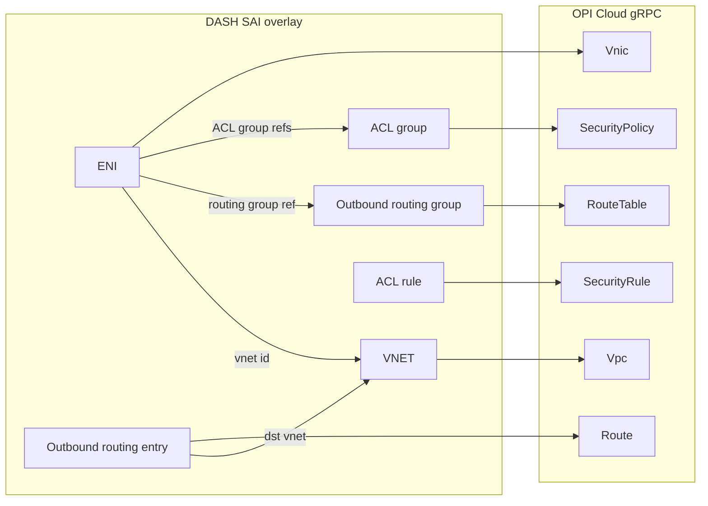

# DASH SAI to OPI protobuf mapping

This document maps SONiC DASH overlay SAI objects to OPI Cloud protobuf
messages. It is the contract a SAI-to-gRPC translation layer should implement
for ENI, VNET, outbound routing, and ACL.

## Header names: `saidash.h` and `saieni.h`

Those filenames are not in current [sonic-net/DASH](https://github.com/sonic-net/DASH)
or the [OCP SAI](https://github.com/opencomputeproject/SAI) experimental tree.

DASH overlay headers are generated from P4 via
[`dash-pipeline/SAI/templates/saiapi.h.j2`](https://github.com/sonic-net/DASH/blob/main/dash-pipeline/SAI/templates/saiapi.h.j2).
The template writes:

```
@file saiexperimental{{ sai_api.app_name | replace('_', '') }}.h
```

so `dash_eni` becomes `saiexperimentaldasheni.h`. The published copies live in
OCP SAI `experimental/` and are included from
[`saiextensions.h`](https://github.com/opencomputeproject/SAI/blob/master/experimental/saiextensions.h).

| Informal name | Current header | SAI API enum | API struct |
| --- | --- | --- | --- |
| `saieni.h` | `saiexperimentaldasheni.h` | `SAI_API_DASH_ENI` | `sai_dash_eni_api_t` |
| `saidash.h` (ENI siblings) | `saiexperimentaldashvnet.h`, `saiexperimentaldashoutboundrouting.h`, `saiexperimentaldashacl.h`, … | `SAI_API_DASH_VNET`, `SAI_API_DASH_OUTBOUND_ROUTING`, `SAI_API_DASH_ACL` | `sai_dash_vnet_api_t`, `sai_dash_outbound_routing_api_t`, `sai_dash_acl_api_t` |

CRUD on DASH objects (`create_*` / `remove_*` / `set_*_attribute` /
`get_*_attribute`) maps to OPI `CloudInfraService` Create/Delete/Update/Get
RPCs on the corresponding resource.

**What is live vs mapping-only** along
SAI-Challenger → gNMI → dashorch → syncd → adapter → CloudInfra `:50051` →
DPU datapath: [`docs/dash-api-flow-status.md`](dash-api-flow-status.md).
**How to run the lab:** [`docs/user-guide.md`](user-guide.md).

## Object mapping

| DASH object | DASH SAI type | SAI header | OPI messages | Proto | gRPC |
| --- | --- | --- | --- | --- | --- |
| ENI | `SAI_OBJECT_TYPE_ENI` | `saiexperimentaldasheni.h` | `Vnic`, `VnicSpec`, `VnicStatus` | `network/cloud/vnic.proto` | `CreateVnic` / `GetVnic` / `UpdateVnic` / `DeleteVnic` |
| ENI MAC map | `SAI_OBJECT_TYPE_ENI_ETHER_ADDRESS_MAP_ENTRY` | `saiexperimentaldasheni.h` | `Mapping` + `L2MappingKey` | `network/cloud/mapping.proto` | `CreateMapping` / … |
| Host PF/VF (ENI attachment) | (underlay SAI port / DASH ENI mode) | `saiexperimentaldasheni.h` (`SAI_ENI_ATTR_DASH_ENI_MODE`) | `Interface`, `HostIfSpec` | `network/cloud/interface.proto` | `CreateInterface` / … |
| VNET | `SAI_OBJECT_TYPE_VNET` | `saiexperimentaldashvnet.h` | `Vpc`, `VpcSpec`, `VpcStatus` | `network/cloud/vpc.proto` | `CreateVpc` / … |
| VNET IP scope (optional) | (no dedicated DASH object; implied by VNET + mappings) | — | `Subnet`, `SubnetSpec` | `network/cloud/subnet.proto` | `CreateSubnet` / … |
| Outbound routing group | `SAI_OBJECT_TYPE_OUTBOUND_ROUTING_GROUP` | `saiexperimentaldashoutboundrouting.h` | `RouteTable`, `RouteTableSpec` | `network/cloud/route.proto` | `CreateRouteTable` / … |
| Outbound routing entry | `SAI_OBJECT_TYPE_OUTBOUND_ROUTING_ENTRY` | `saiexperimentaldashoutboundrouting.h` | `Route`, `RouteSpec`, `RouteAttrs` | `network/cloud/route.proto` | `CreateRoute` / … |
| ACL group | `SAI_OBJECT_TYPE_DASH_ACL_GROUP` | `saiexperimentaldashacl.h` | `SecurityPolicy`, `SecurityPolicySpec` | `network/cloud/networkpolicy.proto` | `CreateSecurityPolicy` / … |
| ACL rule | `SAI_OBJECT_TYPE_DASH_ACL_RULE` | `saiexperimentaldashacl.h` | `SecurityRule`, `SecurityRuleSpec`, `SecurityRuleAttrs` | `network/cloud/networkpolicy.proto` | `CreateSecurityRule` / … |

OPI package: `opi_api.network.cloud.v1alpha1`.
Shared types (`Encap`, `IPPrefix`, `RuleMatch`, `SecurityRuleAction`) live in
`opi_api.network.opinetcommon.v1alpha1`
([`networktypes.proto`](https://github.com/opiproject/opi-api/blob/main/network/opinetcommon/networktypes.proto)).



## ENI → `Vnic`

DASH `SAI_OBJECT_TYPE_ENI` is the tenant workload interface (SONiC HLD: ENI,
VNIC, and vPORT are interchangeable). OPI `Vnic` is the same abstraction:
“tenant workload's interface (VM, container, or bare metal).”

A create-ENI translation typically emits:

1. `Vnic` (identity, MAC, session/CPS limits, policy and route-table refs)
2. `Mapping` with `mac_key` if an `eni_ether_address_map_entry` exists
3. `Interface` with `HostIfSpec` when `SAI_ENI_ATTR_DASH_ENI_MODE` is VM/host
   attached (`VnicSpec.host_if_name_ref`); otherwise `VnicSpec.tunnel_name_ref`

| DASH SAI attribute | OPI field | Notes |
| --- | --- | --- |
| ENI object id | `Vnic.name` | Translator-assigned resource name, pattern `vnic/{vnic}` |
| `SAI_ENI_ATTR_ADMIN_STATE` | `InterfaceSpec.admin_status` on the bound host IF | `Vnic` has no admin-state field. Map enabled → `IF_STATUS_UP` |
| `SAI_ENI_ATTR_VNET_ID` | `VnicSpec.subnet_name_ref` → `SubnetSpec.vpc_name_ref` | DASH binds ENI directly to a VNET. OPI binds VNIC → subnet → VPC |
| `SAI_ENI_ATTR_VM_VNI` | `VnicSpec.fabric_encap` | `Encap.type = ENCAP_TYPE_VXLAN`, `Encap.value.vnid` |
| `SAI_ENI_ATTR_VM_UNDERLAY_DIP` | `MappingSpec.tunnel_name_ref` or `Tunnel` dest IP | Host/VM underlay locator; also related to `VnicSpec.service_ip` for PL |
| MAC from `eni_ether_address_map_entry.address` | `VnicSpec.mac_address` | Exact-match key in DASH; overlay MAC in OPI |
| `SAI_ENI_ATTR_CPS` | `VnicSpec.max_cps` | OPI also has `cps_burst` (DASH has no burst attribute) |
| `SAI_ENI_ATTR_FLOWS` | `VnicSpec.max_sessions` | OPI can split TCP/UDP/ICMP; DASH is a single flow cap |
| `SAI_ENI_ATTR_INBOUND_V4_STAGE{1-5}_DASH_ACL_GROUP_ID` | `VnicSpec.ingress_v4_security_policy_name_ref[]` | DASH has five ordered stages; OPI is a repeated policy list (order = evaluation order) |
| `SAI_ENI_ATTR_INBOUND_V6_STAGE{1-5}_DASH_ACL_GROUP_ID` | `VnicSpec.ingress_v6_security_policy_name_ref[]` | Same staging collapse |
| `SAI_ENI_ATTR_OUTBOUND_V4_STAGE{1-5}_DASH_ACL_GROUP_ID` | `VnicSpec.egress_v4_security_policy_name_ref[]` | OPI egress is “from vnic to network” (DASH outbound) |
| `SAI_ENI_ATTR_OUTBOUND_V6_STAGE{1-5}_DASH_ACL_GROUP_ID` | `VnicSpec.egress_v6_security_policy_name_ref[]` | |
| `SAI_ENI_ATTR_OUTBOUND_ROUTING_GROUP_ID` | `VnicSpec.v4_route_table_name_ref` / `v6_route_table_name_ref` | One DASH group vs two OPI tables (per address family) |
| `SAI_ENI_ATTR_DSCP` / `SAI_ENI_ATTR_DASH_TUNNEL_DSCP_MODE` | `VpcSpec.tos` / `SubnetSpec.tos` / `RouteAttrs.tos` | Closest ToS/DSCP knobs; no pipe-vs-preserve enum on `Vnic` |
| `SAI_ENI_ATTR_PL_SIP`, `PL_SIP_MASK`, `PL_UNDERLAY_SIP` | `VnicSpec.service_ip` plus `RouteClass.ROUTE_CLASS_SERVICE` | Private Link encoding is richer in DASH than in OPI |
| `SAI_ENI_ATTR_PPS`, meter policy ids, HA, flow table, resimulation | — | No first-class OPI Cloud equivalents |

### ENI stats → `TelemetryService.GetVnicMetrics`

SONiC FlexCounter / dashorch poll `sai_get_eni_stats` (standard SAI counter
arrays: `counter_ids[]` → `counters[]`). OPI `inventory.proto` is SMBIOS only
(`InventoryService.GetInventory` on SNAP `:50052` during `sai_api_initialize`).
Dataplane packet/byte counters are read from `TelemetryService` on the
CloudInfra gRPC server (`:50051`), not from SNAP. The adapter looks up
`Vnic.name` from the ENI oid, calls `GetVnicMetrics`, and fills the SAI array.

| DASH SAI counter | OPI field |
| --- | --- |
| `SAI_ENI_STAT_RX_BYTES` | `VnicMetrics.rx_bytes` |
| `SAI_ENI_STAT_RX_PACKETS` | `VnicMetrics.rx_packets` |
| `SAI_ENI_STAT_TX_BYTES` | `VnicMetrics.tx_bytes` |
| `SAI_ENI_STAT_TX_PACKETS` | `VnicMetrics.tx_packets` |
| `SAI_ENI_STAT_FORWARDING_DROP_PACKETS` | `VnicMetrics.forwarding_drops` |
| `SAI_ENI_STAT_POLICY_DROP_PACKETS` | `VnicMetrics.policy_drops` |
| `SAI_ENI_STAT_OTHER_DROP_PACKETS` | `rx_drops + tx_drops` |
| `SAI_ENI_STAT_TOTAL_DROP_PACKETS` | `rx_drops + tx_drops + policy_drops + forwarding_drops` |

Unmapped `SAI_ENI_STAT_*` ids are written as `0` so FlexCounter still gets a
complete array. Missing ENI oid → `SAI_STATUS_ITEM_NOT_FOUND`.

## VNET → `Vpc`

DASH VNET is a 24-bit VXLAN VNI object (`SAI_VNET_ATTR_VNI`). OPI `Vpc` of type
`VPC_TYPE_TENANT` carries that VNI in `fabric_encap`.

| DASH SAI attribute | OPI field | Notes |
| --- | --- | --- |
| VNET object id | `Vpc.name` | Pattern `vpcs/{vpc}` |
| `SAI_VNET_ATTR_VNI` | `VpcSpec.fabric_encap` | `Encap.type = ENCAP_TYPE_VXLAN`, `EncapVal.vnid` |
| (implicit tenant overlay) | `VpcSpec.type = VPC_TYPE_TENANT` | Underlay is a separate OPI VPC type; DASH underlay is classic SAI |
| Optional inherited routing | `VpcSpec.v4_route_table_name_ref`, `v6_route_table_name_ref` | DASH attaches the route group on the ENI, not the VNET |
| Optional inherited ACLs | `VpcSpec.ingress_*` / `egress_*_security_policy_name_ref` | DASH attaches ACL groups on the ENI |
| VNET peering / CA-to-PA | `VPCPeer` and `Mapping` | Cross-VNET reachability is not a VNET attribute in DASH; it is outbound CA-to-PA + routing |

When the translator must host local IPs, also create a `Subnet` under the VPC
(`SubnetSpec.vpc_name_ref`, `fabric_encap` may repeat the VNI). OPI VNICs
require a subnet; DASH ENIs do not.

## Outbound routing → `RouteTable` / `Route`

DASH splits the table (`outbound_routing_group`) from LPM entries
(`outbound_routing_entry` keyed by `destination` + `outbound_routing_group_id`).
OPI uses the same split: `RouteTable` plus `Route` / `RouteInfo`.

| DASH SAI field | OPI field | Notes |
| --- | --- | --- |
| `outbound_routing_group` id | `RouteTable.name` | Pattern `routetables/{routetable}` |
| `SAI_OUTBOUND_ROUTING_GROUP_ATTR_DISABLED` | omit table or empty `RouteTableSpec.routes` | OPI has no disabled flag on `RouteTable` |
| `sai_outbound_routing_entry_t.destination` | `RouteAttrs.prefix` | DASH LPM key → `opinetcommon.IPPrefix` |
| `sai_outbound_routing_entry_t.outbound_routing_group_id` | `RouteSpec.route_table_name_ref` | |
| `SAI_OUTBOUND_ROUTING_ENTRY_ATTR_ACTION` | `RouteAttrs.route_class` + `nh` oneof | See action table below |
| `SAI_OUTBOUND_ROUTING_ENTRY_ATTR_DST_VNET_ID` | `VPCPeerNhInfo.vpc_name_ref` or `OverlayNextHopIPInfo.vpc_name_ref` | Peer-VPC lookup vs overlay NH in current VPC |
| `SAI_OUTBOUND_ROUTING_ENTRY_ATTR_DASH_TUNNEL_ID` | `RouteAttrs.tunnel_name_ref` | Also create `Tunnel` if the DASH tunnel object exists |
| `SAI_OUTBOUND_ROUTING_ENTRY_ATTR_OVERLAY_IP` | `OverlayNextHopIPInfo.nexthop_ip` | Used with `ROUTE_VNET_DIRECT` |
| `SAI_OUTBOUND_ROUTING_ENTRY_ATTR_OVERLAY_DIP` / `SIP` (+ masks) | `Tunnel` encap / service route | Service-tunnel action; DASH is more bit-mask specific |
| `SAI_OUTBOUND_ROUTING_ENTRY_ATTR_UNDERLAY_DIP` / `SIP` | `Tunnel` underlay endpoints | |
| `SAI_OUTBOUND_ROUTING_ENTRY_ATTR_DASH_ENCAPSULATION` | `RouteAttrs.encap.type` / `Tunnel` encap | VXLAN default on both sides |
| `SAI_OUTBOUND_ROUTING_ENTRY_ATTR_TUNNEL_KEY` | `EncapVal.vnid` | |
| Meter class AND/OR, flow-resimulation disable, counter id | — | No OPI Cloud route meters |

### Outbound routing actions

| `sai_outbound_routing_entry_action_t` | OPI translation |
| --- | --- |
| `ROUTE_VNET` | `RouteClass.ROUTE_CLASS_VPC` and `eval_mapping = true`, or `vpc_nh_info` toward `DST_VNET_ID`. CA-to-PA / `Mapping` supplies the TEP |
| `ROUTE_VNET_DIRECT` | `ROUTE_CLASS_VPC` + `overlay_nh_ip_info` with `OVERLAY_IP` |
| `ROUTE_DIRECT` | Overlay NH or `nexthop_name_ref` without extra VNET mapping |
| `ROUTE_SERVICE_TUNNEL` | `RouteClass.ROUTE_CLASS_SERVICE` + `tunnel_name_ref` |
| `DROP` | No dedicated drop route. Closest options: omit a matching prefix (policy deny), or a `SecurityRule` deny. Do not invent a `ROUTE_CLASS` |

## ACL → `SecurityPolicy` / `SecurityRule`

DASH ACL is a group (address family) plus rules (match + action + priority).
OPI `SecurityPolicy` holds the group; `SecurityRule` / `SecurityRuleInfo` holds
each rule. Set `SecurityPolicySpec.stateless = false` for DASH stateful ACL
(SONiC DASH phase-1 requirement).

| DASH SAI field | OPI field | Notes |
| --- | --- | --- |
| ACL group id | `SecurityPolicy.name` | Pattern `securitypolicys/{securitypolicy}` |
| `SAI_DASH_ACL_GROUP_ATTR_IP_ADDR_FAMILY` | `SecurityPolicySpec.address_family` | `IP_AF_INET` / `IP_AF_INET6` |
| (tenant overlay ACL) | `SecurityPolicySpec.type = SECURITY_POLICY_TYPE_TENANT` | Underlay NACL is a singleton in OPI |
| ACL rule id | `SecurityRule.name` / `SecurityRuleInfo.rule_name` | |
| `SAI_DASH_ACL_RULE_ATTR_DASH_ACL_GROUP_ID` | `SecurityRuleSpec.security_policy_name_ref` | |
| `SAI_DASH_ACL_RULE_ATTR_PRIORITY` | `SecurityRuleAttrs.priority` | Both: lower numeric value wins. DASH range is implementation-defined; OPI documents 0–65534 |
| `SAI_DASH_ACL_RULE_ATTR_SIP` | `RuleMatch.l3_match` `src_prefix` / `src_ip_list` | DASH is `sai_ip_prefix_list_t` → OPI `IPList` when compact |
| `SAI_DASH_ACL_RULE_ATTR_DIP` | `dst_prefix` / `dst_ip_list` | |
| `SAI_DASH_ACL_RULE_ATTR_PROTOCOL` | `RuleL3Match.proto_num` (or `src_ip_list` compact proto handling) | DASH `sai_u8_list_t` may need multiple OPI rules if flattened |
| `SAI_DASH_ACL_RULE_ATTR_SRC_PORT` | `RuleL4Match.ports.src_port_range` or `port_list` | DASH `sai_u16_range_list_t` |
| `SAI_DASH_ACL_RULE_ATTR_DST_PORT` | `dst_port_range` | |
| `SAI_DASH_ACL_RULE_ATTR_COUNTER_ID` | `SecurityProfileSpec.rule_stats_enable` | OPI enables stats globally, not per rule object |
| Compact vs flattened lists | `SecurityPolicySpec.rule_format` | `POLICY_RULE_FORMAT_COMPACT` matches DASH list keys |

### ACL actions

| `sai_dash_acl_rule_action_t` | OPI translation |
| --- | --- |
| `PERMIT` | `SecurityRuleAction.SECURITY_RULE_ACTION_ALLOW` and `terminating = true` |
| `DENY` | `SECURITY_RULE_ACTION_DENY` and `terminating = true` |
| `PERMIT_AND_CONTINUE` | `ALLOW` and `terminating = false` (evaluate later policies / stages) |
| `DENY_AND_CONTINUE` | `DENY` and `terminating = false` |

DASH stages 1–5 per direction become consecutive entries in the OPI repeated
policy-name lists on `VnicSpec`. Preserve stage order.

## Suggested create order

OPI references are name strings, so parents should exist first:

1. `Vpc` (DASH VNET)
2. `Subnet` (if local IPs / VNIC attachment require it)
3. `SecurityPolicy` then `SecurityRule` (DASH ACL group/rule)
4. `RouteTable` then `Route` (DASH outbound routing group/entry)
5. `Tunnel` if routing or ENI mode needs it
6. `Interface` for host PF/VF
7. `Vnic` (DASH ENI), wiring policy, route-table, subnet, and host-if refs
8. `Mapping` for ENI MAC and remote CA-to-PA

## Gaps the translator must handle

- DASH meter policies, HA scope, trusted VNI, PA validation, and flow tables
  have no Cloud protobuf peers in `opi-api` `network/cloud`.
- DASH five-stage ACL vs OPI repeated policy lists: collapse stages, keep order.
- One DASH outbound routing group vs per-AF OPI route tables: split or
  duplicate the group when both IPv4 and IPv6 ENI tables are in use.
- `ROUTE_DROP` has no `RouteClass`.
- OPI `Vnic` requires a subnet; DASH ENI only requires a VNET id.
- OPI `VpcSpec.fabric_encap` is the VNI; DASH also stores a per-ENI `VM_VNI`
  that can differ from the VNET VNI (inbound direction). Map both: VNET → VPC
  fabric encap, ENI VM VNI → VNIC fabric encap.
